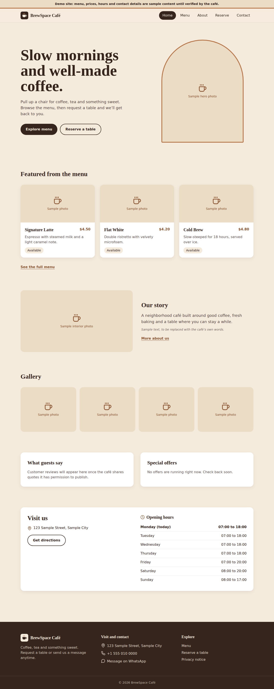
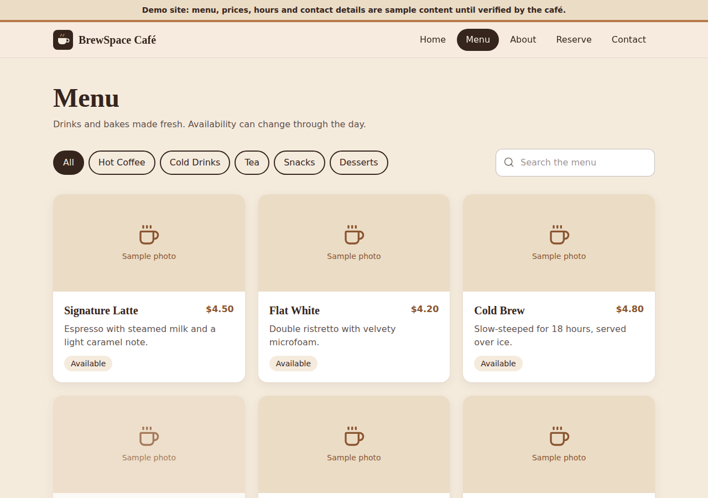
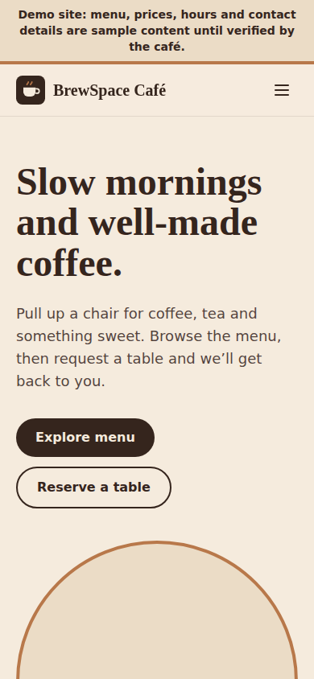
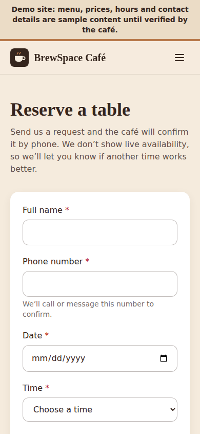

# BrewSpace Café

A responsive café website with a protected admin dashboard. Customers browse the menu, request a table and send enquiries. Admins manage the menu, reservation requests and enquiries.

> **Demo status.** "BrewSpace Café" is a temporary brand. All business details, menu items, prices, hours and photos are **sample placeholders** until verified with the real owner. The public site shows a "Demo site" banner until you set `VITE_SAMPLE_CONTENT=false`.

## Contents
1. [Stack and structure](#1-stack-and-structure)
2. [Quick start (local)](#2-quick-start-local)
3. [Environment variables](#3-environment-variables)
4. [Database setup and first admin](#4-database-setup-and-first-admin)
5. [Testing](#5-testing)
6. [Manual end-to-end check](#6-manual-end-to-end-check)
7. [Configuring for a real café](#7-configuring-for-a-real-café)
8. [Deployment](#8-deployment)
9. [Troubleshooting](#9-troubleshooting)
10. [Security notes and known limits](#10-security-notes-and-known-limits)
11. [Screenshots](#11-screenshots)

## 1. Stack and structure

React + Vite + Tailwind CSS (client), Node.js + Express (API), Supabase PostgreSQL and Auth, Zod validation, Vitest + React Testing Library + Supertest.

```
client/    React app (src/pages, components, layouts, hooks, services, lib, config)
server/    Express API (src/routes, controllers, middleware, validation, config, services)
supabase/  migrations/0001_init.sql, 0002_rls.sql, seed.sql, README.md
tests/db/  SQL security tests run against a real local PostgreSQL
docs/      screenshots
render.yaml   Render blueprint for the API
client/vercel.json   SPA rewrite for Vercel
```

**Architecture.** The browser talks to the Express API for all data. The only direct Supabase use in the browser is **sign-in** (anon key). The API verifies the user's token with Supabase and checks `profiles.role = 'admin'` in the database on **every** admin route. Row Level Security protects the tables as defence in depth if anyone calls Supabase directly with the anon key.

## 2. Quick start (local)

Requires Node.js 20+ and a Supabase project (free tier is fine).

```bash
npm run install:all
cp .env.example server/.env      # keep the SERVER block, fill in real values
cp .env.example client/.env      # keep the CLIENT block, fill in real values
# set up the database first (section 4), then:
npm run dev:server               # http://localhost:4000/api/health
npm run dev:client               # http://localhost:5173
```

The API refuses to start if required variables are missing, and prints which ones.

## 3. Environment variables

`.env.example` documents every variable. Summary:

| Variable | Where | Purpose |
|---|---|---|
| `SUPABASE_URL` | server | Project URL |
| `SUPABASE_SERVICE_ROLE_KEY` | server | **Secret.** Bypasses RLS. Never in client code or a `VITE_` variable |
| `CLIENT_ORIGIN` | server | Allowed browser origin(s), comma-separated, exact, no trailing slash |
| `PORT`, `NODE_ENV`, `BUSINESS_NAME` | server | Runtime |
| `VITE_API_BASE_URL` | client | API URL **including `/api`** |
| `VITE_SUPABASE_URL`, `VITE_SUPABASE_ANON_KEY` | client | Public values used for sign-in |
| `VITE_BUSINESS_*`, `VITE_CURRENCY`, `VITE_LOCALE`, `VITE_SOCIAL_*`, `VITE_SAMPLE_CONTENT` | client | Business details shown on the site |

`VITE_*` values are baked in **at build time**. After changing them you must rebuild or redeploy the client.

Token verification uses `supabase.auth.getUser(token)` with the service-role key, so no JWT secret is needed.

## 4. Database setup and first admin

Full steps are in [`supabase/README.md`](supabase/README.md). In short:

1. Create a Supabase project.
2. In the SQL Editor run, in order: `supabase/migrations/0001_init.sql`, `0002_rls.sql`, then `seed.sql` (fictional demo items only; skip it for a real café and enter the real menu in the admin area).
3. **Disable public sign-ups:** Authentication → Providers → Email → turn off "Allow new users to sign up".
4. Create the first admin: Authentication → Users → *Add user* (email + strong password, auto-confirm). Copy the user's UUID and run, as the project owner:
   ```sql
   update public.profiles set role = 'admin', display_name = 'Owner'
   where user_id = 'PASTE-USER-UUID-HERE';
   ```
   Every new auth user automatically gets a `customer` profile. There is no API or client policy that can change a role; promotion is done only by SQL like the above.

## 5. Testing

```bash
npm run test:server    # 65 API tests (Supertest, mocked Supabase)
npm run test:client    # 46 UI tests (Vitest + React Testing Library, mocked fetch/Supabase)
npm run build          # production build of the client
```

Database security tests (RLS, privilege escalation, constraints) run against a throwaway local PostgreSQL 16. See [`tests/db/README.md`](tests/db/README.md). They use stand-ins for Supabase's `auth` schema, so they complement but **do not replace** the manual check below on your real project.

What the automated tests cover: menu loading, filtering and search; reservation and enquiry validation and success/error states; duplicate-submit prevention; unauthenticated and non-admin access to every admin route; menu create/edit/delete permissions; reservation status validation; rate limiting, CORS and body-size limits; database error handling.

## 6. Manual end-to-end check

Run this against your real Supabase project (locally, then again on the live deployment). Tick each box only once you have seen it work.

- [ ] `GET /api/health` returns `{"status":"ok"}`.
- [ ] The Menu page lists items from the database; category filters and search work; an unavailable item shows "Unavailable today".
- [ ] Submit a reservation for a future date. The page says **pending**, not confirmed. The row appears in Supabase (`reservations`, status `pending`).
- [ ] Submit the exact same reservation again: you get a "already received" message, not a second row.
- [ ] Try a past date and a party size of 50: both are rejected.
- [ ] Submit a contact enquiry. The row appears in `enquiries` with status `new`.
- [ ] Visit `/admin` signed out: you are sent to the login page.
- [ ] Sign in with a **non-admin** account: you see "You don't have admin access" and no data.
- [ ] Sign in as the admin: the dashboard shows correct counts.
- [ ] Add, edit and delete a menu item; the public Menu page reflects each change.
- [ ] Change the test reservation to *confirmed*; filter by status and date; search by name.
- [ ] Mark an enquiry *read*.
- [ ] With the admin's token missing or edited, `curl -i https://YOUR-API/api/admin/summary` returns 401, and with a non-admin token returns 403.
- [ ] Open the site on a phone and a desktop browser; check the mobile menu and both forms.

## 7. Configuring for a real café

1. Get the owner's written confirmation of name, address, phone, WhatsApp, hours, menu and prices. Do not publish anything you cannot verify.
2. Edit the `VITE_BUSINESS_*` values (see `.env.example`). Opening hours, testimonials, offers and photos live in `client/src/config/business.js`.
3. Photos: only add images the café owns or has licensed. Put them in `client/public/` and list them under `photos` (`{ src, alt }`); until then the site shows labeled placeholders.
4. Testimonials: add only real quotes you have permission to publish. Leave the list empty otherwise.
5. Replace the draft privacy notice (`client/src/pages/Privacy.jsx`) with text reviewed by the owner and, where required, a legal professional.
6. Replace `YOUR-DOMAIN.example` in `client/public/sitemap.xml` and `robots.txt`.
7. Set `VITE_SAMPLE_CONTENT=false` only when steps 1 to 5 are complete.

Reservations are **requests**. There is no live table availability; the café confirms by phone and sets the status in the admin area.

## 8. Deployment

**You must do these steps yourself; nothing here has been deployed or verified live.**

1. **Supabase:** create the project, run the migrations (section 4), disable public sign-ups, create the first admin.
2. **API on Render:** New → Blueprint, point at this repo (uses `render.yaml`), or create a Web Service with root directory `server`, build `npm install --omit=dev`, start `npm start`, health check `/api/health`. Set `SUPABASE_URL`, `SUPABASE_SERVICE_ROLE_KEY` and `CLIENT_ORIGIN` (you can set a placeholder now and update it in step 4). Render serves HTTPS automatically. Note the API URL.
3. **Client on Vercel:** import the repo, set **Root Directory** to `client` (framework: Vite). Set `VITE_API_BASE_URL` (`https://YOUR-API.onrender.com/api`), `VITE_SUPABASE_URL`, `VITE_SUPABASE_ANON_KEY` and the `VITE_BUSINESS_*` values. Deploy. `client/vercel.json` makes deep links such as `/menu` work.
4. **CORS:** set `CLIENT_ORIGIN` on the API to the exact Vercel URL (and your custom domain if any), comma-separated, no trailing slash. Redeploy the API.
5. **Supabase Auth URLs:** Authentication → URL Configuration → set Site URL to the live site.
6. **Verify HTTPS:** both URLs should load with a valid certificate; `VITE_API_BASE_URL` must be `https://`.
7. Run the manual check in section 6 against the live URLs.
8. Record the live URLs here once verified:
   - Site: `TBD`
   - API: `TBD`

## 9. Troubleshooting

| Symptom | Likely cause and fix |
|---|---|
| API exits on start with "Invalid environment configuration" | A server variable is missing or malformed; the message names it. |
| Browser console: CORS error / "Origin not allowed" | `CLIENT_ORIGIN` doesn't exactly match the site's origin (check `https`, `www`, trailing slash). Redeploy the API after changing it. |
| Menu shows "Could not reach the server" | Wrong `VITE_API_BASE_URL` (must end in `/api`), API asleep or down, or the client wasn't rebuilt after changing env. Some free hosting tiers pause idle services, so the first request can be slow. |
| Admin login says "Incorrect email or password" | Wrong credentials, or the user isn't confirmed in Supabase. |
| Admin login says sign-in "isn't configured" | `VITE_SUPABASE_URL` / `VITE_SUPABASE_ANON_KEY` missing at build time. |
| Signed in but "You don't have admin access" | The user's `profiles.role` is still `customer`; run the promotion SQL in section 4. |
| Admin pages 401 repeatedly | Token expired or the API's `SUPABASE_URL` / service key belong to a different project than the client's. |
| 429 "Too many submissions" | Public forms allow 10 submissions per 15 minutes per IP. |
| Deep links (e.g. `/menu`) 404 on Vercel | Root Directory not set to `client`, so `vercel.json` isn't applied. |
| Fonts look generic | Google Fonts blocked by the network; the site falls back to Georgia / system sans-serif. |

## 10. Security notes and known limits

- Admin authorization is enforced server-side on every `/api/admin` route (valid token **and** `role = 'admin'` read from the database). Hiding links is only a convenience.
- Reservation status is always set to `pending` by the server; client-supplied `status`, `role` or unknown fields are rejected. Prices are validated and rounded server-side.
- Helmet, CORS allow-list, 10 kB body limit, rate limits, honeypot fields, parameterized queries (Supabase client) and sanitized search input are in place. Logs record error messages only, not request bodies, tokens or customer data.
- RLS: anonymous users can read only available menu items; nothing else is public. Roles can't be changed from the client.
- **Sign-in rate limiting** is handled by Supabase Auth (the browser signs in directly), not by this API. Review those limits in your Supabase dashboard.
- The honeypot and rate limits reduce, but do not eliminate, spam. Add a CAPTCHA (e.g. Cloudflare Turnstile) if spam becomes a problem.
- No email or SMS notifications are sent. Admins see new requests in the dashboard.
- No live availability: the café must confirm each request.
- Real production use needs a privacy review for your jurisdiction and a backup plan for the database (Supabase offers backups on paid plans).

## 11. Screenshots

Captured from the production build in headless Chromium against a **stub API with sample data** (not a live deployment). The sandbox could not load Google Fonts, so headings appear in the fallback serif font. Replace these with captures of your live site.

| | |
|---|---|
|  |  |
|  |  |

Admin screens have not been captured yet.
